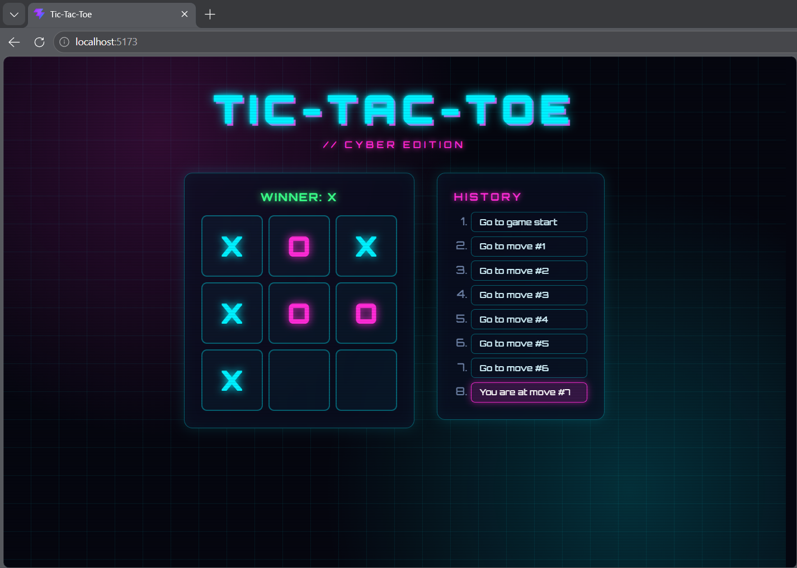

# React Tic-Tac-Toe

Tic-tac-toe built by following the [official React tutorial](https://react.dev/learn/tutorial-tic-tac-toe), with extra features from the tutorial's challenges list and a custom neon cyber theme.



## Features

- Two-player game (X and O) with winner detection
- Move history with time travel: jump back to any previous move
- Custom neon cyber styling

## Extra challenges completed

- [x] 1. For the current move only, show "You are at move #..." instead of a button
- [x] 2. Rewrite `Board` to use two loops to make the squares instead of hardcoding them
- [ ] 3. Add a toggle button to sort the moves in ascending or descending order
- [ ] 4. Highlight the three winning squares, and show a draw message when no one wins
- [ ] 5. Display the location of each move as (row, col) in the history list

## Custom additions beyond the tutorial

- Neon cyber theme with a title and grid background
- Fixed-width history panel to prevent layout shift
- Move list grows with the game instead of scrolling

## Tech stack

- React
- Vite

## Getting started

```bash
npm install
npm run dev
```

Then open the local address shown in the terminal (usually `http://localhost:5173`).

## Build

```bash
npm run build
npm run preview
```